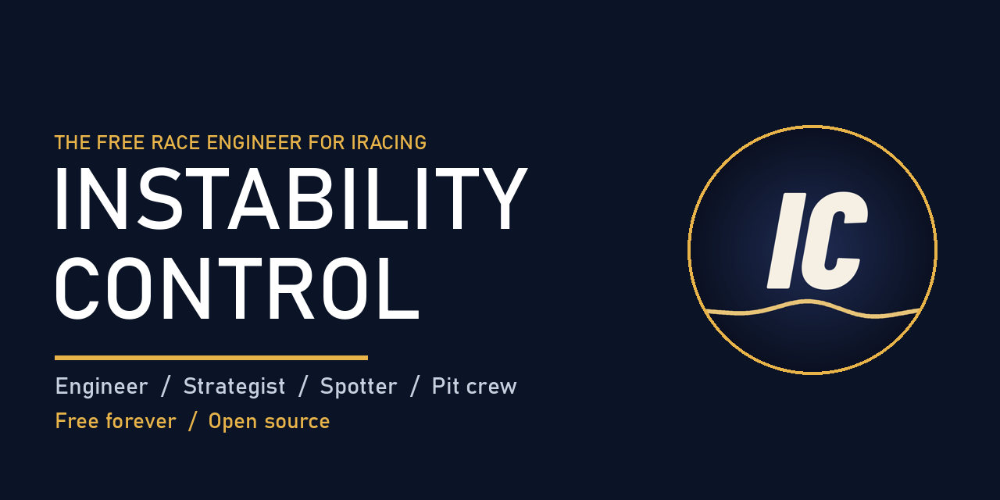
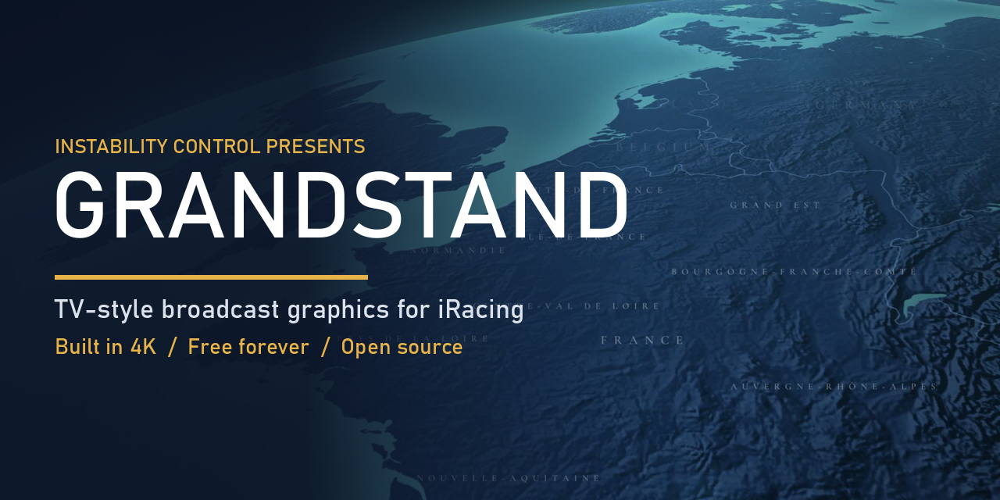

# INSTABILITY CONTROL

**Free sim racing tools for iRacing. No paid tiers, no locked features, for everybody.**

---

<table>
<tr>
<td width="50%" valign="top">

### [Instability Control](https://github.com/instabilitycontrolracing/instability-control)
A free race engineer that talks to you on the radio. Engineer, strategist, spotter and pit crew, plus lap analysis and an iPad app.
</td>
<td width="50%" valign="top">

### [Grandstand](https://github.com/instabilitycontrolracing/grandstand)
TV-style broadcast graphics for your races. Track openers, timing tower, story cards, podium. Built in 4K, scales up to 8K and cinema screens.
</td>
</tr>
</table>

---

### Why free

I race on iRacing, and I don't like people charging for this stuff and getting an advantage just because they have the money. So everything here is free, forever. Donations help keep it going, but they don't unlock anything.

### League and event broadcasts

I produce iRacing league and event broadcasts with Grandstand: track opener, class-by-class grid, timing tower, battle and pit cards, podium, and a camera director that follows the battles. Your league's logo and sponsors on screen. Email **instabilitycontrol@gmail.com** with **EVENT** in the subject line.

Want your brand on the broadcast? Email with **SPONSOR** in the subject line.

### Found a problem?

Use **Report a problem** on either project's Issues tab. I read every report.
